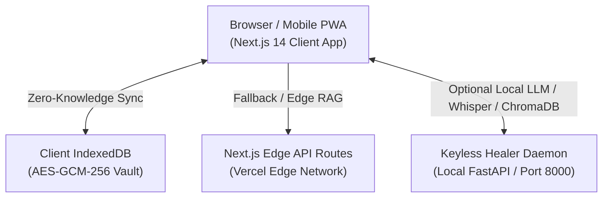

# Emotional Intelligence Healer (EIH) — Neuro-Vedantic Mind Sanctuary

[](https://nextjs.org/)
[](https://www.typescriptlang.org/)
[](https://tailwindcss.com/)
[](#zero-knowledge-cryptographic-vault)
[](LICENSE)

> **Autonomous, 100% Keyless, Privacy-First Universal PWA & Voice Sanctuary for Ayurvedic Sattvavajaya Chikitsa & Modern Neuropsychology**  
> **Production Sanctuary:** [https://eih-chi.vercel.app](https://eih-chi.vercel.app)  
> **Machine-Readable LLM Specification:** [`public/llms.txt`](public/llms.txt)

---

## 🏛️ System Architecture

EIH operates on a **Vercel Hybrid Architecture** designed to deliver instant global edge performance while safeguarding clinical data privacy:



### Architecture Directives (Vercel Hybrid Model)
1. **Split-Execution Model:** The Python backend (`keyless_healer/`) runs locally or on dedicated hardware to execute local LLM inference, ChromaDB vector stores, and Microsoft Edge Neural voice synthesis. It is never bundled into Vercel Serverless or Edge functions. See [AGENTS.md](AGENTS.md) for directives.
2. **Deterministic Edge Fallback:** Next.js Edge routes (`/api/chat/fallback`, `/api/library`, `/api/safety`) ensure 100% functionality even when the local Python daemon is offline.
3. **CORS Permissiveness:** The FastAPI daemon in `keyless_healer/app.py` includes permissive CORS for `localhost:3000`, `127.0.0.1:3000`, and all `*.vercel.app` deployments.

---

## 🌟 Clinical Core & Pillars

EIH bridges Western neuropsychology with classical Eastern mind sciences:

1. **Theory of Constructed Emotion & 27-D Topology:** Multi-signal emotion mapping based on Barrett, Porges, and Cowen & Keltner.
2. **Ayurvedic Sattvavajaya Chikitsa:** Mind control therapy and Triguna equilibrium balancing (Sattva, Rajas, Tamas).
3. **Bhagavad Gita Cognitive Contemplation:** 13 clinically annotated verses retrieved via hybrid RAG, providing non-repetitive philosophical grounding and actionable karma guidance.
4. **4-Stage Cognitive Behavioral Therapy (CBT):** Negative automatic thought detection, distortion naming, evidence-based challenges, and rational reframing across 14 condition profiles.
5. **5-Stage Neuro-Ocular Trataka Protocol:** Digital eye-safety compliant (max 120s external gaze) visual fixation meditation with 5 modalities: Bindu, Flame, Murti, Pratibimb (mirror WebRTC), and Shoonya (void).
6. **4-Phase Guided Wellness Conversation Flow:** Voice-first clinical state machine escorting the user through mood discovery, Gita wisdom, CBT reframing, and Trataka meditation. See [README-WELLNESS-FLOW.md](README-WELLNESS-FLOW.md).

---

## 📂 Repository Directory Layout

```
EIH/
├── app/                        # Next.js 14 App Router (pages & edge API endpoints)
│   ├── (session)/              # Core Sanctuary session interface & modals
│   ├── api/                    # Edge API routes (audio, chat, gita, health, library)
│   └── layout.tsx              # Root layout with self-hosted fonts & SEO metadata
├── components/                 # Shared UI & modular clinical views
│   ├── gita/                   # Text-only Bhagavad Gita library & card views
│   ├── wellness-flow/          # 4-Phase Guided Wellness conversation components
│   └── seo/                    # Schema.org JSON-LD & clinical editorial guide
├── lib/                        # Core application business logic & utilities
│   ├── audio/                  # Audio manager, STT corrector, karaoke tokenizer
│   ├── db/                     # Web Crypto AES-GCM vault & IndexedDB storage
│   ├── i18n/                   # Multilingual clinical catalog (en, hi, es, fr, de)
│   ├── knowledge/              # Emotion classifier, Gita library, CBT library, RAG
│   └── wellness-flow/          # State machine, intent parser, emotion engine
├── keyless_healer/             # Dedicated Python FastAPI backend daemon
│   ├── app.py                  # Daemon entrypoint with CORS & API endpoints
│   └── lib/                    # Local ChromaDB, whisper, and neural voice synthesis
├── tests/                      # Automated verification test suite
│   ├── run-all-tests.js        # Master test runner (100% pass guarantee)
│   └── ...                     # Comprehensive unit, clinical, & regression tests
├── public/                     # Static PWA assets, manifest, audio worklets
│   └── llms.txt                # Canonical machine-readable LLM specification
├── AGENTS.md                   # Agent directives & hybrid architecture rules
├── README-WELLNESS-FLOW.md     # 4-Phase guided conversation flow documentation
├── .cursorignore               # AI context boundary configuration for Cursor
├── .copilotignore              # AI context boundary configuration for GitHub Copilot
├── package.json                # Lean dependency manifest (5 runtime dependencies)
├── tsconfig.json               # TypeScript strict configuration
└── vercel.json                 # Edge & CDN caching headers configuration
```

---

## 🔒 Zero-Knowledge Cryptographic Vault

- **Algorithm:** Native Web Crypto API `AES-GCM-256` with 310,000 PBKDF2 iterations.
- **Storage:** Local device IndexedDB only (`EIH_KeyVault`).
- **Telemetry & Transcripts:** Never transmitted unencrypted to external servers.
- **Panic Purge:** Instant one-click client-side wipe of cryptographic keys and history.

---

## 🚀 Getting Started

### Prerequisites
- Node.js `>=18.17.0` (LTS recommended)
- Python `>=3.10` (for optional local neural voice & local LLM daemon)

### 1. Installation

```bash
# Clone the repository
git clone https://github.com/your-org/eih.git
cd eih

# Install frontend dependencies
npm install
```

### 2. Run the Development Server

```bash
npm run dev
```

Visit [http://localhost:3001](http://localhost:3001) in your browser.

### 3. Run the Python Keyless Healer Daemon (Optional)

```bash
# Set up Python virtual environment
python -m venv .venv
source .venv/bin/activate  # On Windows: .venv\Scripts\activate
pip install -r requirements-backend.txt

# Start the daemon on port 8000
python app.py
```

---

## 🧪 Testing & Verification

EIH enforces strict automated quality gates across clinical, linguistic, and performance dimensions:

```bash
# Run master automated test suite
npm test

# Run TypeScript type check
npx tsc --noEmit

# Run Next.js linter
npm run lint

# Build production bundle
npm run build
```

---

## 📄 License

This project is licensed under the MIT License. See [LICENSE](LICENSE) for details.
